# 운영 장애 대응 AI Agent — 최종 보고서

**조사 대상·관측 근거·런북·대화 문맥을 연결하는 서비스 장애 대응 지원 시스템**

## 1. 표지 및 소속 정보

| 항목 | 내용 |
|---|---|
| 소속 / 반 / 이름 | **광주 / 2반 / 김영민** |
| 프로젝트 | AI Service Mini Project |
| 주제 | 기존 운영 장애 대응 AI Agent의 신뢰성 개선 및 Docker 실행 환경 구축 |
| 최종 실행 구성 | OpenAI · LangGraph v2 · MCP · Docker Compose |
| 기록 기준일 | 2026-10-22 |
| 제출 링크 | [GitHub 최종 보고서](https://github.com/youngminG044/skala-AI-Service#readme) |

이 프로젝트는 모니터링 정보를 조회하고 관련 대응 매뉴얼인 **런북(Runbook)**을 찾아, 관측 사실과 참고 절차를 제공하는 시스템을 개선한 작업입니다. 핵심 개선은 **① 조사 대상 확인·누락 방지 ② 사실·인용 검증 ③ 서비스별 런북 검색 ④ 후속 대화·세션 유지**입니다.

최신 자동 테스트는 **144/144개**, 최종 OpenAI 통합 시나리오는 **14/14건**, Docker 환경의 실제 사용자 요청은 **8/8건**에서 정해 둔 기준을 충족했습니다. 고정 15건의 검색 평가에서는 임베딩 점수 선택 대비 재순위화 적용 후 선택 집합 일치율이 **66.7% → 93.3%**로 높아졌습니다. 이 수치는 각 평가 범위의 결과이며 전체 자연어 질문에 대한 정확도를 뜻하지 않습니다.

> 모니터링 수치와 런북은 샘플 자료입니다. 시스템은 실제 인프라의 조치를 실행하지 않으며, 장애 원인에 대한 가설은 미검증 추정으로 표시합니다.

**바로 보기:** [문제와 개선](#improvements) · [적용 기술](#technology) · [구현 결과와 시연](#results) · [교훈과 한계](#lessons) · [실행·제출 안내](#delivery)

<a id="improvements"></a>

## 2. 문제 개선 및 신규 구현 사항

### 2.1 기존 시스템의 문제점

개선 전에는 질문을 처리하고 답변을 완성하는 것과, 사용자가 요청한 대상을 정확히 조사하고 근거 있는 답변을 제공하는 것 사이에 차이가 있었습니다. 보존한 코드와 실제 실행 기록에서 다음 문제를 확인했습니다.

| 영역 | 개선 전 확인한 문제 | 해결 과제 |
|---|---|---|
| 조사 대상 | 미등록 `billing-service`가 `auth-service`로 대체됨. 일부 복수 대상 계획에서는 누락 대상을 보완하지 않음 | 대상 확정·제외 조건·등록 여부를 확인하고 요청 대상별 수집 여부를 검사 |
| 사실과 근거 | 실제 로그 조회 없이 “로그를 분석했다”고 응답. 잘못된 수치나 마지막 시도의 부적합 초안을 통과시키는 코드 경로 존재 | 관측 원본과 답변을 대조하고 근거가 없는 서술·인용을 반려 |
| 런북 | 결제·캐시를 함께 조사해도 CPU 런북만 조회하는 사례 존재 | 서비스별 관측 증상으로 검색하고 각 문서를 해당 서비스의 근거와 연결 |
| 후속 대화와 화면 복원 | 후속 질문의 대상이 기본 서비스로 바뀌는 통제 사례. DB에 대화가 남아 있어도 새로고침하면 화면 미복원 | 확인한 대상과 대기 상태를 저장하고, 과거 답변 복원과 현재 상태 재조회를 구분 |

OpenAI의 실제 실행과 고정 입력을 주입한 코드 검사는 구분해 기록했습니다. 다음 화면은 당시 OpenAI 실행의 원본 사본이며, 개선 후 화면과 입력·시점·표시 영역이 완전히 동일한 정량 비교 실험은 아닙니다.

<details>
<summary>개선 전 실제 실행 화면 4개 보기</summary>

**미등록 대상이 다른 서비스로 대체됨**

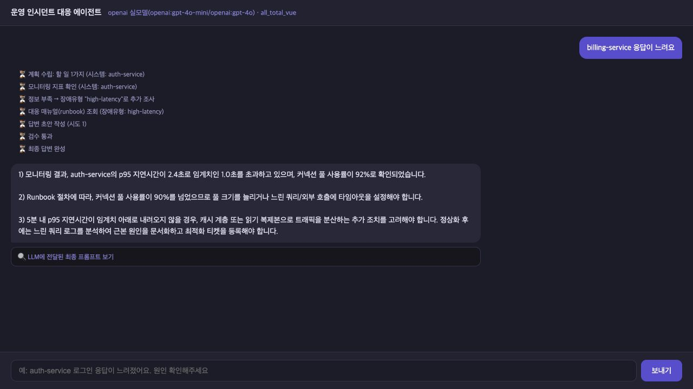

**로그 조회 근거 없이 로그 분석 결과를 단정함**

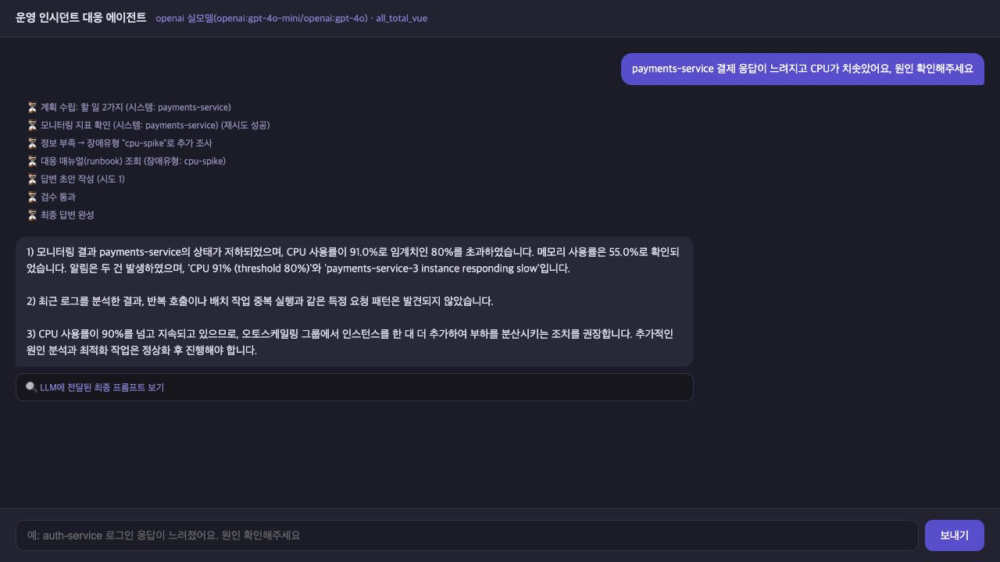

**복수 서비스 조사에서 CPU 런북만 확보함**

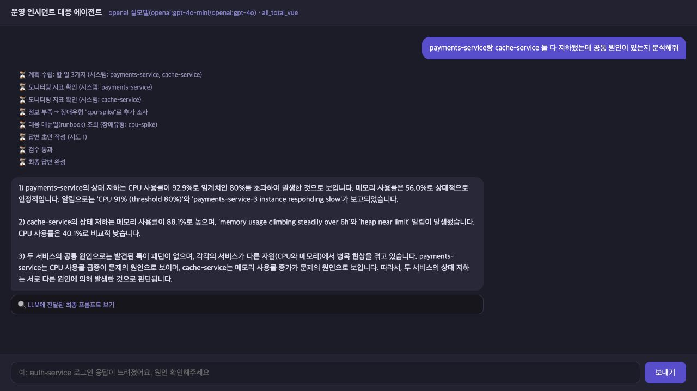

**새로고침 후 저장된 대화가 화면에 복원되지 않음**

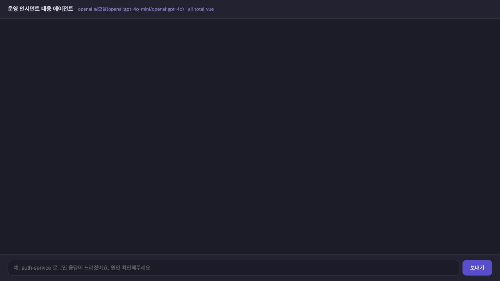

</details>

### 2.2 핵심 개선 기능 4개

| 개선 기능 | 구현한 동작 | 관련 코드 |
|---|---|---|
| 조사 대상 확인·누락 방지 | 명시한 서비스와 제외 조건을 처리. 대상이 없거나 모호하면 확인 질문. 계획의 누락·중복·범위 이탈을 보정하고 수집 결과 대조 | [targets.py](agent/targets.py), [graph.py](agent/graph.py) |
| 사실·인용 검증 | 관측 사실은 원본 근거에서 구성. 가설·추가 확인·인용할 단계는 모델이 제안. 대상·수치·출처·인용을 대조하고 최대 3회 작성 후 실패하면 사실만 제공하는 제한 응답 | [grounding.py](agent/grounding.py), [contracts.py](agent/contracts.py) |
| 서비스별 런북 검색 | 서비스별 활성 알림으로 검색어 구성 → 임베딩 상위 2개 후보 → LLM 재순위화 → MCP Resource로 원문 확보 → 서비스·출처·문서 해시 연결 | [runbook_search.py](agent/runbook_search.py), [runbook_rerank.py](agent/runbook_rerank.py) |
| 후속 대화·세션 유지 | 이전 확인 대상과 확인 대기 상태를 연결. 후속 질문에는 새 관측 수집. 대화·메타데이터·문맥을 함께 저장하고 새로고침·재시작 후 복원 | [context.py](agent/context.py), [session_store.py](agent/session_store.py), [web_chat.html](web_chat.html) |

수집 실패나 검색 오류는 해당 서비스의 상태로 남깁니다. 검증 전 장애 답변 초안은 사용자 화면에 표시하지 않으며, SSE로 진행 상태와 최종 결과를 전달합니다.

### 2.3 추가 구현: Docker로 실행·데이터 관리

서버별 실행 대신 Docker Compose로 frontend와 backend를 함께 관리하도록 구성했습니다. MCP 서버 2개는 backend의 하위 프로세스로 실행하고, 인덱스 생성과 테스트는 일회성 컨테이너로 분리했습니다.

- 대화 DB와 벡터 인덱스를 **이름 있는 볼륨 2개**에 저장합니다.
- backend는 인덱스를 읽기 전용으로 사용하며, indexer가 생성·갱신합니다.
- API 키는 backend와 indexer에만 전달합니다.
- 비관리자 사용자, 상태 확인, 기동 순서, 로그 회전과 종료 정책을 설정했습니다.

구성은 [compose.yaml](compose.yaml), [Dockerfile](Dockerfile), [사전 점검 진입점](docker/entrypoint.py)에서 확인할 수 있습니다.

<a id="technology"></a>

## 3. 적용 기술 요소

### 3.1 Multi-Agent와 LangGraph

**Supervisor가 조사 흐름을 제어하고, 역할을 나눈 LangGraph 노드가 작업을 수행하는 구조**입니다. 계획·수집·분석·작성·검증을 서로 다른 노드로 구성했으며, 각 역할마다 독립 프로세스나 자율 에이전트 런타임을 둔 구성은 아닙니다.

| 역할 | 실제 노드 | 동작 |
|---|---|---|
| 문맥·분류·대상 결정 | `context`, `route`, `resolve_targets`, `clarify_target`, `chat_answer` | 일반 대화·장애 조사를 나누고 대상 확인 질문 처리 |
| 계획·실행 제어 | `plan`, `gate` | MCP 표준 절차로 계획 구성. 분석 불필요 시 분석 작업 제거 |
| 근거 수집·재계획 | `research`, `replan_check` | 서비스별 수집, 누락 재수집, 검색 결과에 따른 원문 조회 작업 추가 |
| 분석·작성·검증·완료 | `analysis`, `write`, `validate`, `finalize` | 필요할 때 분석하고 구조화 답변을 작성·대조한 뒤 최종 결과 구성 |

그래프는 총 **13개 노드**입니다. 모니터링 누락 보완과 런북 추가 수집은 코드가 판단하는 제한된 재계획이며, 개방형 LLM 재계획은 아닙니다. 수집 작업은 비동기로 구성하고 일시 오류에는 재시도를 적용합니다. MCP 클라이언트의 공유 연결 호출은 잠금으로 보호하므로 모든 도구가 동시에 실행된다는 의미는 아닙니다.

### 3.2 MCP: Tool · Resource · Prompt

| 표준 인터페이스 | 제공 기능 | 사용 목적 |
|---|---|---|
| Tool | `get_monitoring_status` | 요청 시점의 서비스 상태·CPU·메모리·알림 조회 |
| Tool | `search_runbooks` | 관측 증상에 관련된 런북 검색 후보와 선택 결과 반환 |
| Resource | `runbook://incident-response/{incident_type}` | 선택한 런북 원문 확보 |
| Prompt | `incident_analysis_prompt` | 계획 단계에 표준 진단 절차 제공 |

[ops MCP 서버](mcp_server.py)와 [docs MCP 서버](mcp_server_docs.py)를 stdio로 연결합니다. Resource·Prompt 제공 서버를 목록 조회로 찾는 [클라이언트](agent/mcp_client.py)를 사용합니다. docs 서버는 연결되어 있으나 현재 장애 조사에서 API 문서를 사용하지 않습니다.

### 3.3 RAG: 의미 검색과 문서 주입

RAG는 검색한 외부 문서를 답변 작성의 근거로 제공하는 방식입니다. 이 프로젝트는 **OpenAI 임베딩 + JSON 벡터 인덱스 + 코사인 유사도 + LLM 재순위화**를 사용합니다.

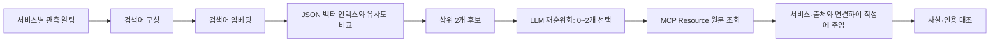

- 문서 임베딩은 `text-embedding-3-small`의 **1,536차원** 벡터입니다.
- 짧은 런북 **6개**를 문서당 검색 단위 하나로 사용합니다.
- 검색어는 관측 알림에서 결정적으로 구성합니다. LLM 기반 Query Rewriting과 키워드/BM25 검색은 미적용입니다.
- 재순위화는 `gpt-4o-mini`가 후보 원문을 평가하는 방식입니다. 후보 밖의 문서는 선택할 수 없습니다.
- 정상·무알림이면 검색을 생략하며, 적합한 문서가 없으면 빈 선택을 허용합니다.
- 문서 해시·모델·차원을 확인하고 기존 벡터를 재사용합니다.

**별도 Vector DB는 도입하지 않았습니다.** 소규모 문서를 JSON 파일로 관리해 구성 요소를 줄였으며, 제출 가이드의 “Vector DB 기반 검색”과는 적용 범위가 다릅니다. 문서 증가·메타데이터 필터·동시 갱신이 필요해지면 별도 저장소 도입을 검토해야 합니다.

### 3.4 아키텍처 및 코드 품질

| 항목 | 적용 내용 |
|---|---|
| 모듈화 | 대상 결정·문맥·검색·근거 검증·저장·모델 어댑터 분리 |
| 데이터 계약 | Pydantic 기반 조사 대상·근거·초안·검증 결과·문맥 구조 |
| 의존성 주입 | [SupervisorDeps](agent/deps.py)로 모델·MCP·저장소를 전달하고 노드에 명시적으로 주입 |
| 단위·통합 테스트 | 모델·MCP 대체 자료로 오류·누락·재시도·원자 저장·POST/SSE 경로 검사 |
| 저장 일관성 | 메시지 쌍·메타데이터·문맥을 SQLite 단일 트랜잭션으로 저장 |
| 실행 재현성 | Python 3.11 이미지 digest와 직접·전이 의존성 97개 버전 고정 |

### 3.5 관측 가능성 및 평가

[서버](server.py), [그래프](agent/graph.py), 모델·MCP 호출에는 LangSmith `@traceable` 계측 코드가 있습니다. 요청의 `langsmith_run_id`와 단계별 이벤트도 처리합니다. 다만 **현재 권장 OpenAI 실행과 Compose에서는 외부 추적 전송을 비활성화**했으며, 이번 검증을 LangSmith 대시보드에서 평가한 것으로 표현하지 않습니다.

이번 평가에는 고정 정답과 코드 판정, 실제 API 요청·응답 기록, 관측 원본·인용 대조, 화면 캡처를 사용했습니다. **별도 LLM-as-a-Judge 평가 체계는 미구현**입니다. 검색에 사용하는 LLM 재순위화와 최종 품질을 채점하는 Judge는 다른 역할입니다.

| 제출 가이드의 기술 요소 | 현재 적용 상태 |
|---|---|
| Supervisor·전문 역할 분리·재계획 | LangGraph 역할별 노드와 코드 기반 재계획 적용 |
| MCP Tool·Resource·Prompt | 적용 |
| RAG 의미 검색·문서 주입 | 적용. 별도 Vector DB는 미도입 |
| 모듈화·의존성 주입·단위 테스트 | 적용 |
| LangSmith 트레이싱 | 계측 코드 존재. 기본 실행의 외부 전송 비활성화 |
| LLM-as-a-Judge 평가 | 미구현. 향후 개선 과제 |

### 3.6 기타 적용 기술

FastAPI는 질문 처리·SSE·이력 API를 제공하고, Vue 화면은 진행 상태·검증 결과·대화 복원을 표시합니다. SQLite는 세션을 저장하며 Docker Compose는 실행과 데이터 볼륨을 관리합니다.

| 모델 역할 | 기본 설정 |
|---|---|
| 분류·계획·선택적 분석·재순위화 | `gpt-4o-mini` |
| 가설·추가 확인·참고 절차 단계 선택 | `gpt-4o` |
| 문서·검색어 임베딩 | `text-embedding-3-small` |

초기 대상·사실 검증 구현은 Ollama에서 확인했고, Step 4부터 OpenAI로 전환해 검색·세션·최종 통합·Docker 동작을 검증했습니다. 모델 전환만으로 개선 효과를 주장하지 않습니다.

<a id="results"></a>

## 4. 구현 결과

### 4.1 시스템 아키텍처

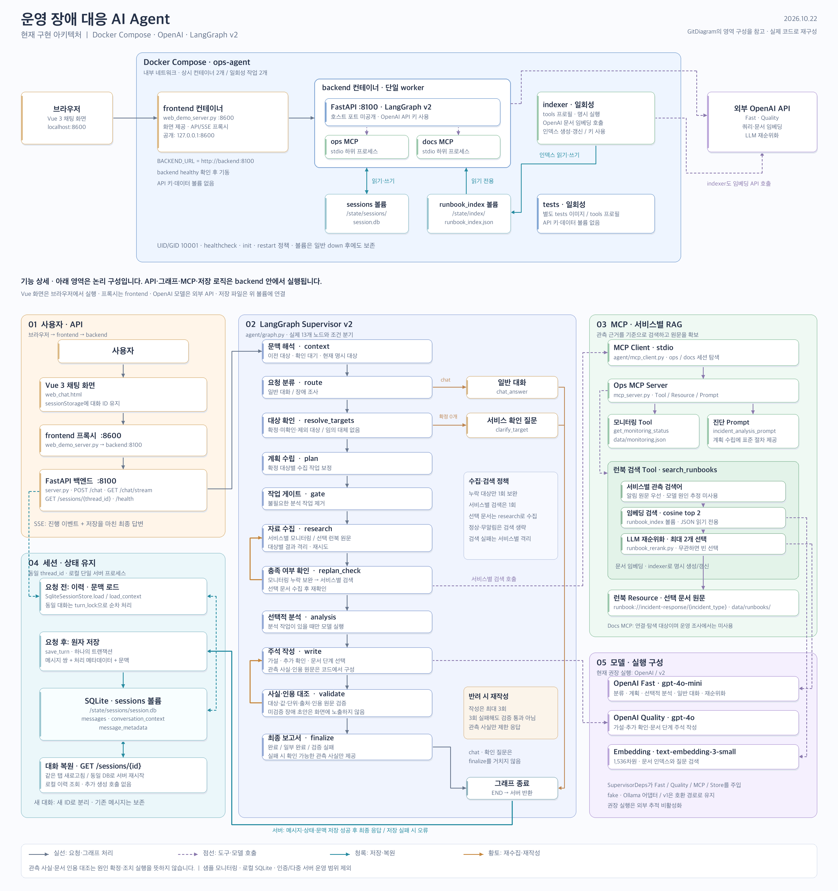

[확대 가능한 SVG 원본](assets/report/architecture.svg)

상단은 Docker 배포 구성이고, 하단은 API·LangGraph·MCP/RAG·저장소·모델 사이의 논리 구성입니다. 실제 코드와 Compose 설정을 대조해 작성한 이미지이며 GitDiagram 자동 생성 결과는 아닙니다.

- 상시 컨테이너는 **frontend·backend 2개**, 명시적으로 실행하는 일회성 서비스는 **indexer·tests 2개**입니다.
- 브라우저는 frontend의 `127.0.0.1:8600`에 접속하며, frontend는 내부 `backend:8100`으로 요청을 중계합니다.
- backend 안에서 FastAPI·LangGraph와 ops/docs MCP 하위 프로세스가 실행됩니다.
- 대화 DB는 `/state/sessions/session.db`, 검색 인덱스는 `/state/index/runbook_index.json`에 있습니다.
- OpenAI API와 브라우저는 컨테이너 외부에 있습니다.

### 4.2 장애 조사 처리 흐름

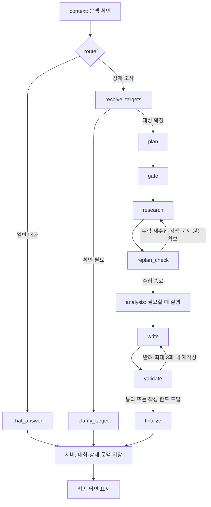

작성 한도에 도달해도 검증을 강제로 통과시키지 않습니다. 최종 검증 실패 시 확인 가능한 관측 사실만 표시하고 제한 상태를 반환합니다.

### 4.3 주요 기능 시연

아래 화면은 기존 실제 OpenAI 실행에서 확보한 원본의 사본입니다. Step 6 화면은 좁은 브라우저 패널, Docker 화면은 1280×720이며 긴 답변의 일부만 보이는 캡처도 있습니다.

#### 시연 1. 대상 없는 질문 → 확인 질문

입력: `메모리가 계속 증가해요. 상태와 대응 절차를 확인해줘`

서비스를 임의로 지정하지 않고 어느 서비스를 조사할지 확인합니다. 이어서 `cache-service`라고 답하면 원래 증상을 연결해 캐시만 조사합니다.

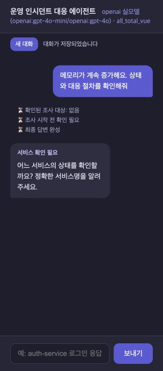

#### 시연 2. 관측 사실·가설·참고 절차 구분

모니터링 값과 출처는 관측 사실로 구성하고, 모델의 추정은 “가설”, 런북 단계는 URI·단계 번호가 있는 “원문 인용”으로 구분합니다. 화면의 대조 통과는 원본 일치를 의미하며 원인 확정을 의미하지 않습니다.

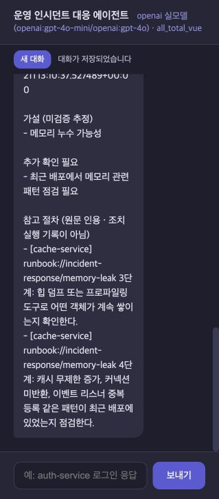

#### 시연 3. 복수 서비스 → 서비스별 런북

입력: `payments-service와 cache-service 상태와 대응 절차를 확인해줘`

두 서비스 모두 수집하고 각 관측으로 검색합니다. 해당 실행에서 결제는 CPU·지연 문서, 캐시는 메모리 문서를 확보했으며, 아래 화면에는 결제 CPU 절차와 캐시 메모리 절차의 원문 인용이 보입니다.

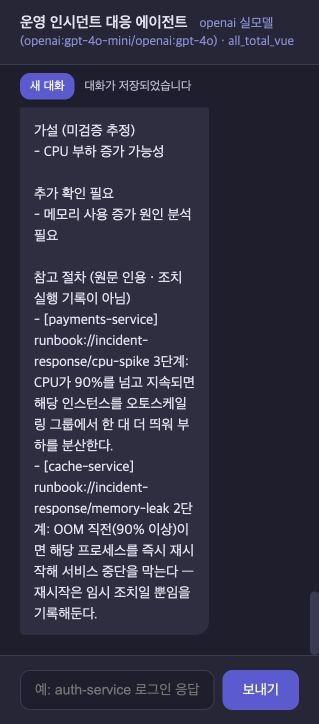

#### 시연 4. 재시작 후 대화·확인 대기 상태 복원

실제 서버를 종료하고 같은 샘플 DB로 다시 실행한 뒤, 화면에서 메시지 10개와 확인 대기 상태가 복원됐습니다. 여러 서비스를 조사한 후 “그 서비스”라고 한 요청도 어느 서비스인지 다시 확인하는 상태로 유지됐습니다.

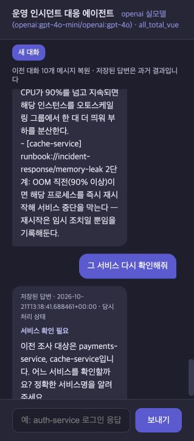

#### 시연 5. 컨테이너 재생성 → 후속 질문으로 새 관측

Docker 환경에서 컨테이너를 재생성한 뒤 `지금은 정상화됐어?`라고 질문하면 이전 캐시 대상을 연결하고 새 모니터링 정보를 조회합니다. 이 실행에서는 CPU·메모리가 `39.1% / 87.6%`에서 `40.8% / 88.4%`로 바뀌고 출처 ID도 달라졌습니다. 샘플 도구의 값 변화이며 실제 운영 추세는 아닙니다.

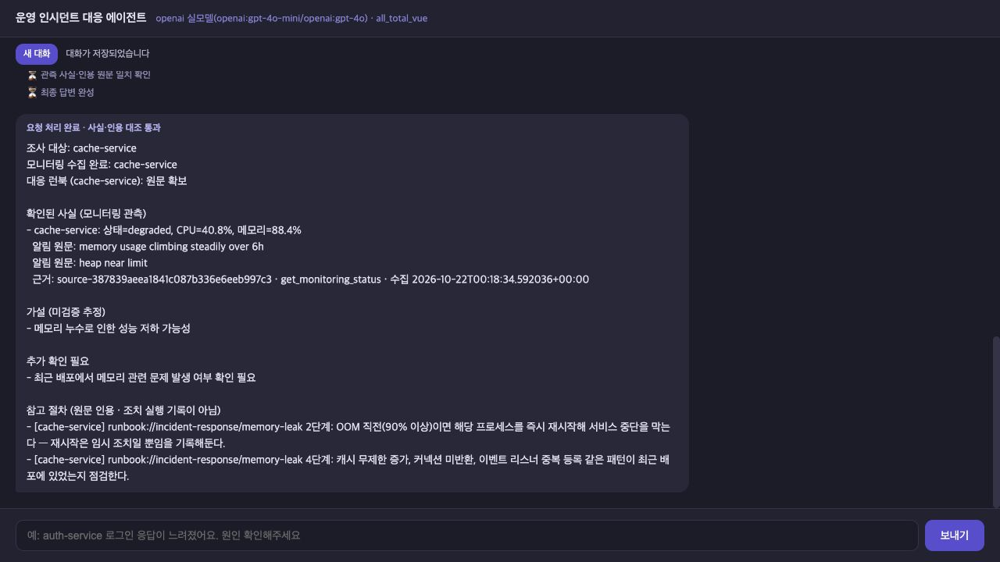

새 대화에서 같은 후속 질문을 하면 이전 대상이 적용되지 않고 서비스 확인 질문을 합니다.

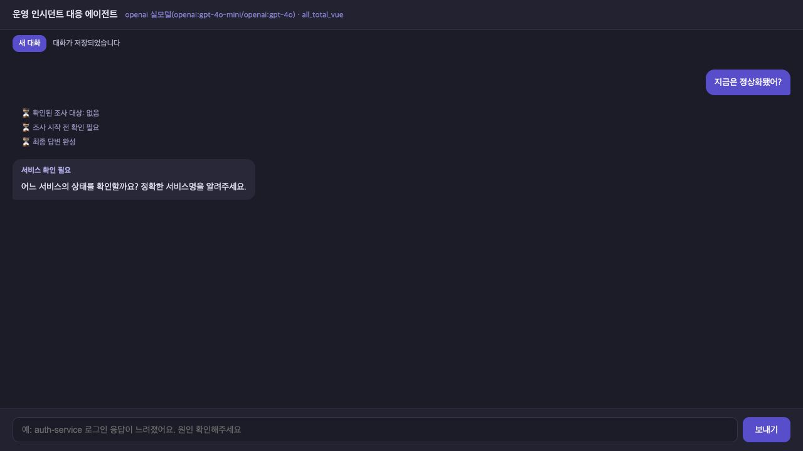

### 4.4 기능 검증 결과

다음은 **이미 완료된 실행 기록**의 요약입니다. 보고서 작성 중 새로 유료 호출하거나 테스트를 실행한 결과는 아닙니다.

| 검증 범위 | 결과 | 해석 |
|---|---|---|
| Step 6 자동 테스트 | 137/137 통과 | 모델·MCP를 주입한 기능 검사 |
| Docker 도입 후 최신 자동 테스트 | 호스트 144/144, Linux ARM64 컨테이너 144/144 통과 | 기존 137개에 Docker 관련 7개 추가. 서로 독립인 288개 검사로 합산하지 않음 |
| 최종 OpenAI 통합 시나리오 | 14/14 기준 충족 | 조사 응답 9건·확인 질문 4건·일반 대화 1건 |
| Step 6 실제 화면 요청 | 7/7 기준 충족 | API 14건과 별도로 기록한 UI/SSE 요청 |
| Docker 실제 사용자 요청 | 8/8 기준 충족 | POST 5건·UI/SSE 3건. 완료 응답 5건·확인 질문 3건 |
| 사실·인용 별도 대조 | Step 6 조사 응답 21건의 관측 연결 및 인용 36개 일치 | 초기·최종·화면 실행 포함. 모든 자연어 의미나 런북 적합성 검사는 아님 |
| 저장 복원 | 새로고침·서버 재시작·컨테이너 재생성 후 이력·메타데이터·문맥 일치 | 관측한 복원 구간의 추가 생성 API 호출 0회 |

확인 질문과 일반 대화는 사실·인용 검증을 실행하지 않는 `not_run` 상태입니다. 시나리오 통과 건수를 검증된 장애 답변 수로 해석하지 않습니다.

초기 통합 실행에서는 “캐시 + 미등록 서비스” 요청의 미조사 대상 서술이 반려되어 제한 응답이 발생했습니다. 작성 모델에 정상 수집 대상의 허용 목록을 명시한 뒤 전체 14건을 다시 확인했습니다. 검증 규칙을 완화해 통과시킨 것은 아닙니다.

### 4.5 검색 평가와 재순위화 도입 효과

**같은 임베딩 후보에 대해 점수만으로 선택한 결과와 LLM 재순위화 결과를 비교**했습니다. 전체 시스템의 개선 전 버전과 개선 후 버전을 같은 조건으로 재실행한 비교는 아닙니다.

평가 자료는 Step 4에서 고정한 관측 **15건**이며, 정답이 있는 사례 13건·정답 문서 14개·무관 사례 2건으로 구성됩니다. Step 6에서 사례별 1회 실행한 회귀 평가로, 새로운 홀드아웃 자료는 아닙니다.

| 지표 | 임베딩 점수 선택 | LLM 재순위화 적용 |
|---|---:|---:|
| 후보 Recall@2 | 14/14문서, 100% | 동일 후보 사용 |
| 최종 선택 집합 일치 | 10/15, 66.7% | 14/15, 93.3% |
| 선택 Precision | 80.0% | 93.3% |
| 선택 Recall | 85.7% | 100% |
| 불필요하게 선택한 문서 | 3개 | 1개 |
| 무관 사례의 빈 선택 | 2/2 | 2/2 |
| 평균 검색 시간 | 0.322초 | 검색 + 재순위화 1.280초 |

Recall@2는 정답 문서가 후보 2개 안에 들어간 비율입니다. 선택 집합 일치는 최종 선택 문서 전체가 정답 집합과 정확히 같은 사례의 비율입니다.

재순위화로 선택 집합 일치율이 **26.7%p** 높아진 대신 평균 **0.958초**, 15건 합계 **9,127토큰**이 추가됐습니다. 정답 후보는 이미 모두 검색되고 있었으므로, 최종 선택을 개선하는 데 재순위화가 유효했습니다.

남은 오류 **E05**에서는 “응답 지연·커넥션 풀 포화·느린 DB 쿼리” 관측에 `high-latency` 외에 `db-down`도 선택했습니다. DB 접속 불가나 중단 관측이 없는데 대응 범위를 넓힌 사례로, 최종 선택이 항상 정확하지 않다는 한계가 남아 있습니다.

### 4.6 응답 시간·API 사용량

Step 6 최종 조사 응답 9건의 평균 시간은 **5.978초**, 중앙값은 **5.882초**, 범위는 **3.528~7.321초**였습니다. 단일 실행 관측값이며 부하 시험 결과나 운영 지연 보장은 아닙니다.

| 실행 기록 | 실제 API 호출 | 총 토큰 | 포함 범위 |
|---|---:|---:|---|
| Step 6 | 161회 | 76,718 | 초기 실패·평가 도구 재시도·최종 API·화면·검색 평가 |
| Docker 확인 | 29회 | 16,065 | 사용자 요청 8건의 내부 호출과 최초 문서 인덱스 생성 1회 |

사용자 질문 한 건은 분류·계획·작성·임베딩·재순위화 등의 여러 내부 호출을 만들 수 있습니다. Docker 최초 인덱스는 6문서·1,517토큰을 사용했고, 같은 자료로 다시 실행했을 때 6문서를 재사용해 추가 호출은 0회였습니다. 실제 청구액은 산정하지 않았으며 기존 `cost_usd`의 모의 요율을 비용 실측으로 사용하지 않았습니다.

<details>
<summary>수치·화면의 원본 기록 위치</summary>

다음은 개발 작업 폴더 기준 경로입니다. 이 공개 저장소에는 보고서용 이미지 사본과 본문의 요약을 포함하며, 원본 비교·실행 자료는 별도로 보존합니다.

- 개선 전 관측: `before_improve/BASELINE_REPORT.md`, `before_improve/screenshots/`
- 최종 통합 결과: `after_improve/step6/STEP6_REPORT.md`, `after_improve/step6/verification.json`
- 검색 수치: `after_improve/step6/retrieval_evaluation/summary.json`
- 사실·인용 대조: `after_improve/step6/results/fact_and_citation_audit.json`
- Step 6 API 사용량: `after_improve/step6/results/api_usage.json`
- Docker 검증·사용량: `after_improve/docker/DOCKER_REPORT.md`, `after_improve/docker/api_usage.json`
- 아키텍처: `after_improve/architecture/current_architecture.png` 및 `.svg`

이 경로는 저장소 내부 링크가 아닙니다. 원본은 루트의 보존 폴더에 두고, 보고서에 사용하는 이미지 사본만 `assets/report/`에 포함했습니다.

</details>

<a id="lessons"></a>

## 5. 교훈

### 5.1 한계 및 트레이드오프

| 선택 | 얻은 효과 | 한계·대가 |
|---|---|---|
| 사실을 코드로 구성하고 인용을 원문과 대조 | 수치·대상·출처·원문 일치를 검사 가능 | 장애 원인이나 자연어의 모든 의미·조치 적합성까지 검증하지는 못함 |
| 검증 후 최종 답변 표시 | 반려될 장애 답변 초안의 화면 노출 방지 | 작성 중에는 답변 대신 진행 상태를 보게 됨 |
| 임베딩 + LLM 재순위화 | 고정 검색 평가에서 최종 선택 개선 | 추가 지연·토큰과 과다 문서 선택 1건 |
| JSON 벡터 인덱스 | 6개 문서를 별도 DB 서버 없이 관리 | 대규모 검색·동시 갱신·필터 요구에는 재설계 필요 |
| 규칙 기반 후속 문맥 해석 | 대상 선택 우선순위와 확인 동작을 예측 가능하게 구성 | 지원 표현·정확한 서비스 ID 범위를 벗어나면 추가 확인 필요 |
| SQLite·단일 backend worker | 로컬 저장·원자성·동일 대화 순서 처리 단순화 | 다중 서버 간 동시 처리·인증·계정 동기화 미구현 |
| Docker Compose | 서버 기동·환경·볼륨 관리 통합 | 공개 운영 배포·고가용성까지 제공하는 구성은 아님 |

모델·샘플 데이터·문서가 바뀌면 결과도 달라질 수 있습니다. 개선 전 보존본과 개선본 전체에 대한 동일 조건의 종합 정량 비교는 이번 기록만으로 완료됐다고 판단하지 않습니다.

### 5.2 향후 추가 개선 사항

1. **검색 과다 선택 감소:** DB 중단을 뒷받침하는 관측 조건을 더 명확히 반영하고, 키워드/BM25와 의미 검색을 결합하는 하이브리드 검색을 비교합니다. 새 평가 자료에서 선택 정확도·불필요한 문서 수·응답 시간·토큰을 함께 측정합니다.
2. **평가 체계 확장:** 기존 고정 회귀 자료와 별도의 홀드아웃을 구성하고 반복 실행합니다. 원인 추정·설명 품질에는 LLM-as-a-Judge를 보조 평가로 도입하되, 수치·인용 검사는 원본 대조를 유지합니다.
3. **관측 도구 활용:** 데이터 전송 범위를 정한 뒤 LangSmith 추적을 활성화해 단계별 지연·재시도·모델 호출을 분석합니다.
4. **운영·데이터 확장:** 실제 모니터링 연결, 사용자 인증·권한, 대화 목록과 이력 페이지 분할, 다중 worker 저장·잠금 정책을 설계합니다. 문서 증가 시 Vector DB와 검색 단위 분할을 검토합니다.

### 5.3 수행 소감 — 작성 초안

이번 개선에서 핵심은 답변을 생성하는 기능만 추가하는 것이 아니라, **무엇을 조사했고 어떤 근거로 답했는지 확인할 수 있는 흐름을 만드는 것**이었습니다. 대상 확정, 근거 구조화, 검증 실패 시 제한 응답, 대화 복원을 연결하면서 각 단계의 책임을 명확히 하는 설계의 중요성을 정리할 수 있었습니다.

검색에서는 정답이 후보에 포함되는 것과 최종 답변에 필요한 문서만 선택하는 것이 별개의 문제임을 확인했습니다. 재순위화가 선택을 개선했지만 지연과 토큰이 추가되고 오선택도 남았으므로, 기능 도입 여부는 수치와 실패 사례를 함께 보고 판단해야 합니다.

Docker 적용에서는 실행 환경과 저장 데이터를 나누는 작업이 재시작 후 사용자 경험까지 연결된다는 점을 확인했습니다. 이후에는 지원하는 범위와 검증하지 못한 범위를 명확히 설명하는 시스템으로 발전시키고자 합니다.

<a id="delivery"></a>

## 6. 실행 및 제출 안내

### 6.1 실행 방법

Docker Desktop을 실행하고 이 README가 있는 폴더에서 진행합니다. 최초 한 번 `.env`를 준비한 뒤 본인의 OpenAI API 키를 설정합니다.

```bash
cp -n .env.example .env
```

```dotenv
OPENAI_API_KEY=본인의_API_키
```

```bash
docker compose config --quiet
docker compose build backend tests
docker compose run --rm indexer
docker compose up -d --wait
```

브라우저에서 [로컬 채팅 화면](http://localhost:8600)을 엽니다. 인덱스 최초 생성과 실제 질문 처리에는 OpenAI API 비용이 발생합니다.

```bash
# 유료 API를 호출하지 않는 자동 테스트
docker compose run --rm tests

# 서비스 상태·로그
docker compose ps
docker compose logs -f

# 종료: 데이터 볼륨 유지
docker compose down
```

질문 API는 `POST /chat`, 진행 이벤트는 `GET /chat/stream`, 이력은 `GET /sessions/{thread_id}`, 상태 확인은 `GET /health`입니다. Docker에서는 frontend 프록시를 통해 접근합니다.

### 6.2 상세 구현·실행 문서

- [Docker 실행·백업·문제 대응](doc/docker.md)
- [로컬 실행과 통합 확인](doc/execution_guide.md)
- [조사 대상 확인·누락 방지](doc/target_scope.md)
- [사실·근거 검증](doc/grounding.md)
- [런북 검색·인덱스](doc/runbook_search.md)
- [후속 대화·세션 유지](doc/session_continuity.md)
- [공통 데이터 구조](doc/contracts.md)
- [기능 확인 질문](doc/regression_test_queries.md)

### 6.3 외부 접근 확인

제출 주소는 [공개 GitHub 저장소의 README](https://github.com/youngminG044/skala-AI-Service#readme)입니다. **2026-10-22에 인증 없는 HTTP 요청으로 저장소와 당시 게시된 README가 모두 HTTP 200으로 응답하는 것을 확인했습니다.** 이는 현재 원격 게시본의 접근 확인이며, 이번 로컬 수정본이 게시됐다는 의미는 아닙니다.

최종 제출 전에는 이 README와 `assets/report/`의 이미지 사본을 사용자가 GitHub에 반영한 뒤, 로그아웃 또는 시크릿 창에서 보고서·아키텍처·시연 이미지를 다시 확인해야 합니다. 보고서 링크는 공개 문서이며 로컬 채팅 서버 접속 링크와는 다릅니다.
