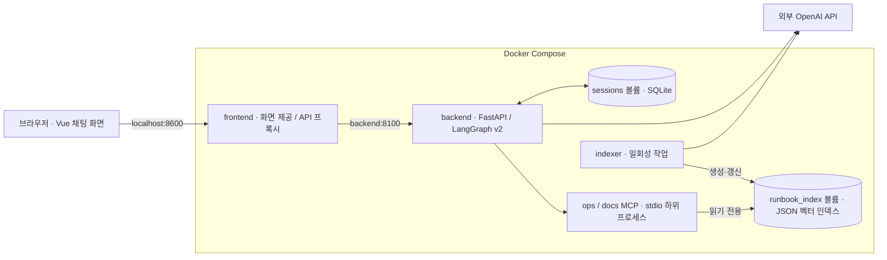

# 운영 장애 대응 AI Agent

서비스의 모니터링 정보를 조회하고, 관련 런북을 검색해 관측 사실과 대응 절차를 제공하는 AI 에이전트입니다.

LangGraph로 조사 흐름을 구성하고, MCP로 모니터링 도구와 런북에 접근합니다. 서비스별로 수집한 근거를 바탕으로 답변을 작성하며, 관측값과 인용 원문을 검증한 후 사용자에게 표시합니다.

현재 기본 실행 구성은 **Docker Compose · OpenAI · LangGraph v2**입니다.

> 모니터링 데이터와 런북은 예제 자료입니다. 답변의 가설은 미검증 추정이며, 제시된 절차를 실제 시스템에 실행하는 기능은 포함하지 않습니다.

## 주요 기능

| 기능 | 동작 |
|---|---|
| 조사 대상 확인·누락 방지 | 서비스가 불명확하면 확인 질문을 하고, 여러 서비스 요청에서는 대상별 수집 여부를 확인합니다. |
| 관측 사실·인용 검증 | 상태·수치·출처와 런북 인용을 원본 근거에 대조합니다. 검증 전 장애 답변 초안은 화면에 표시하지 않습니다. |
| 서비스별 런북 검색 | 각 서비스의 관측 알림으로 검색어를 구성하고, 임베딩 검색과 LLM 재순위화로 관련 문서를 선택합니다. |
| 후속 대화·세션 유지 | 이전 조사 대상을 연결해 새 상태를 조회하고, 저장된 대화·처리 상태·문맥을 복원합니다. |

## 아키텍처



- `frontend`와 `backend`가 상시 서비스로 실행됩니다.
- MCP 서버 2개는 backend 컨테이너의 하위 프로세스로 실행됩니다.
- 호스트에는 frontend의 `127.0.0.1:8600`만 공개합니다.
- `indexer`와 `tests`는 명시적으로 실행하는 일회성 서비스입니다.
- 대화 DB와 검색 인덱스는 컨테이너와 분리된 볼륨에 보존합니다.

## 빠른 시작

### 1. 환경 설정

Docker Desktop을 실행하고, 이 README가 있는 폴더에서 명령을 실행합니다.

`.env`가 없으면 예제 파일을 복사합니다.

```bash
cp -n .env.example .env
```

`.env`의 OpenAI API 키를 본인 키로 설정합니다.

```dotenv
OPENAI_API_KEY=본인의_API_키
```

기본 모델 구성은 다음과 같습니다.

| 역할 | 기본 모델 |
|---|---|
| 요청 분류·계획·재순위화 | `gpt-4o-mini` |
| 가설·추가 확인·런북 단계 선택 | `gpt-4o` |
| 문서·검색어 임베딩 | `text-embedding-3-small` · 1,536차원 |

API 키는 backend와 indexer의 환경 변수로 전달하며 이미지에 복사하지 않습니다. frontend와 tests에는 전달하지 않습니다.

### 2. 이미지 빌드

```bash
docker compose config --quiet
docker compose build backend tests
```

Python 3.11 기반 이미지와 `requirements-docker.lock`에 고정된 의존성을 사용합니다.

### 3. 런북 인덱스 생성

```bash
docker compose run --rm indexer
```

런북 6개를 임베딩하고 인덱스 볼륨에 저장합니다. 동일 문서·모델·차원의 벡터는 재사용하고 변경된 문서만 갱신합니다.

최초 인덱스 생성과 변경 문서 처리에는 OpenAI API 비용이 발생합니다. 서버 시작 시 인덱스를 자동 생성하지 않으므로 최초 실행 전에 이 단계를 완료해야 합니다.

### 4. 서비스 실행

```bash
docker compose up -d --wait
docker compose ps
```

브라우저에서 다음 주소를 엽니다.

http://localhost:8600

8600 포트를 다른 프로그램이 사용하면 `.env`에 `FRONTEND_PORT`를 지정합니다.

```dotenv
FRONTEND_PORT=8601
```

## 사용 예시

다음 순서로 기능을 확인할 수 있습니다.

| 입력·행동 | 기대 동작 |
|---|---|
| `메모리가 계속 증가해요. 상태를 확인해줘` | 조사할 서비스 확인 |
| `cache-service` | 확인한 서비스의 모니터링·런북 조회 |
| `지금은 정상화됐어?` | 이전 서비스의 현재 자료를 새로 조회 |
| `payments-service와 cache-service 상태와 대응 절차를 확인해줘` | 두 서비스 조사와 서비스별 런북 연결 |
| `auth-service 말고 cache-service만 확인해줘` | 제외 조건을 반영해 캐시만 조사 |
| 화면 새로고침 | 같은 탭의 저장된 대화와 당시 처리 상태 복원 |
| 새 대화에서 `지금은 정상화됐어?` | 서비스 확인 질문 |

저장된 답변 복원은 과거 결과 조회입니다. 현재 상태를 확인하려면 후속 질문으로 다시 조사해야 합니다.

## 처리 흐름

```text
질문·이전 문맥 확인
  → 일반 대화 / 장애 조사 분류
  → 조사 대상 확인
  → 서비스별 모니터링 수집
  → 관측 알림 기반 런북 검색·재순위화
  → 선택한 런북 원문 확보
  → 관측 사실 구성·가설 및 참고 절차 작성
  → 사실·출처·인용 대조
  → 대화·메타데이터·문맥 저장
  → 최종 답변
```

사실·인용 대조에 실패하면 최대 3회 작성하며, 계속 실패하면 확인 가능한 관측 사실만 제공하는 제한 응답을 반환합니다.

## RAG 구성

런북 검색은 다음 방식으로 동작합니다.

1. 각 서비스의 관측 알림 원문으로 검색어를 구성합니다.
2. 검색어를 OpenAI API로 임베딩합니다.
3. JSON 인덱스의 문서 벡터와 코사인 유사도를 계산해 상위 2개 후보를 찾습니다.
4. OpenAI LLM이 후보 원문을 재평가해 최대 2개를 선택합니다.
5. 선택 문서를 MCP Resource로 조회하고 서비스·관측 출처와 연결합니다.

짧은 런북 문서 하나를 검색 단위 하나로 사용합니다. 모델이 원인을 추정해 검색어를 다시 쓰는 Query Rewriting은 적용하지 않습니다. 재순위화는 OpenAI LLM의 문서 적합성 평가 방식입니다.

정상 상태이고 활성 알림이 없으면 검색을 생략합니다. 검색 실패나 관련 문서가 없는 경우에는 해당 상태를 표시하고 확보한 관측 사실을 유지합니다.

## 데이터 저장

| 데이터 | Docker 경로 | 접근 |
|---|---|---|
| 대화·처리 메타데이터·문맥 | `/state/sessions/session.db` | backend 읽기·쓰기 |
| 런북 임베딩 인덱스 | `/state/index/runbook_index.json` | backend 읽기 전용, indexer 읽기·쓰기 |

대화 메시지 쌍·메타데이터·문맥은 하나의 트랜잭션으로 저장합니다. 같은 `thread_id` 요청은 단일 backend 프로세스 안에서 순서대로 처리합니다.

일반 `docker compose down`은 데이터 볼륨을 유지합니다. 같은 데이터를 사용하려면 동일한 Compose 프로젝트 이름으로 실행해야 합니다.

## 실행·종료 관리

```bash
# 상태 확인
docker compose ps

# 로그 확인
docker compose logs -f

# 재시작
docker compose restart

# 소스 변경 후 이미지 갱신·기동
docker compose build backend
docker compose up -d --wait

# 종료 — 데이터 볼륨 유지
docker compose down
```

런북을 변경한 경우에는 이미지 갱신 후 인덱스를 다시 생성합니다.

```bash
docker compose build backend
docker compose run --rm indexer
docker compose up -d --wait
```

백업과 문제 대응은 [Docker 실행 가이드](doc/docker.md)를 참고합니다.

## API

| 방식 | 경로 | 역할 |
|---|---|---|
| `POST` | `/chat` | 질문 처리 |
| `GET` | `/chat/stream` | SSE 진행 이벤트·최종 답변 |
| `GET` | `/sessions/{thread_id}` | 저장된 대화·메타데이터·문맥 조회 |
| `GET` | `/health` | 서비스 상태 확인 |

Docker에서는 frontend 프록시를 통해 접근합니다.

```bash
curl -X POST http://localhost:8600/chat \
  -H 'Content-Type: application/json' \
  -d '{"message":"cache-service 상태와 대응 절차를 확인해줘","thread_id":"example-001"}'
```

실제 질문 처리에는 OpenAI API 비용이 발생합니다.

## 테스트

```bash
docker compose build tests
docker compose run --rm tests
```

자동 테스트는 모델과 MCP를 대체한 자료를 사용하며 실제 OpenAI API를 호출하지 않습니다.

로컬 Python 환경에서 실행하려면 다음 명령을 사용합니다.

```bash
.venv/bin/python -m unittest discover -s tests -v
```

## 주요 파일

```text
.
├── README.md
├── Dockerfile
├── compose.yaml
├── requirements-docker.lock
├── server.py                 # API·SSE·대화 조회
├── web_demo_server.py        # 화면 제공·API 프록시
├── web_chat.html             # Vue 채팅 화면
├── mcp_server.py             # 모니터링·런북 도구
├── mcp_server_docs.py        # 문서 MCP 서버
├── agent/
│   ├── graph.py             # LangGraph 조사 흐름
│   ├── targets.py           # 조사 대상 식별
│   ├── context.py           # 후속 대화 문맥 해석
│   ├── contracts.py         # 공통 데이터 구조
│   ├── grounding.py         # 사실·인용 구성 및 검증
│   ├── runbook_search.py    # 임베딩 검색·인덱스
│   ├── runbook_rerank.py    # 후보 재순위화
│   ├── openai_llm.py        # OpenAI 모델 호출
│   └── session_store.py     # SQLite 대화 저장
├── data/
│   ├── monitoring.json
│   └── runbooks/
├── docker/
│   └── entrypoint.py        # 역할별 사전 점검·실행
├── sh/
│   └── build_runbook_index.py
├── tests/
└── doc/
```

## 동작 범위와 한계

- 현재 실행 범위는 로컬·단일 backend worker입니다. 인증·권한과 다중 서버 동시 처리는 추가 구성이 필요합니다.
- 사실·인용 검증 통과는 관측값과 원문이 일치한다는 의미입니다. 장애 원인과 런북 적합성까지 확정하지는 않습니다.
- 임베딩·재순위화는 불필요한 런북을 선택할 수 있습니다.
- 후속 지칭 해석은 지원 표현과 정확한 서비스 ID 범위에서 동작합니다.
- 기존 `cost_usd` 필드는 모의 요율 계산값이므로 실제 청구액으로 사용하지 않습니다.
- OpenAI API와 Vue CDN 사용에는 인터넷 연결이 필요합니다.

## 상세 문서

- [Docker 실행·관리](doc/docker.md)
- [로컬 실행·전체 기능 확인](doc/execution_guide.md)
- [조사 대상 확인과 누락 방지](doc/target_scope.md)
- [사실·근거 검증](doc/grounding.md)
- [런북 검색과 인덱스](doc/runbook_search.md)
- [후속 대화와 세션 유지](doc/session_continuity.md)
- [공통 데이터 구조](doc/contracts.md)
- [기능 확인 질문](doc/regression_test_queries.md)
