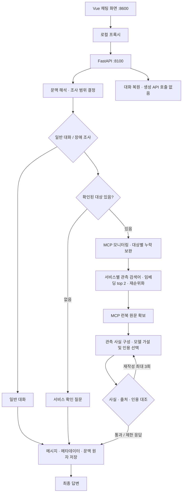

# 운영 장애 대응 AI Agent

현재 권장 실행은 **OpenAI + v2**다. 조사 대상 확인, 사실·인용 대조, 서비스별 런북 검색·재순위화, 후속 대화·세션 복원을 제공한다.

처음 실행할 때는 [OpenAI 실행·통합 확인 가이드](execution_guide.md)를 따른다. 키와 인덱스를 준비하고 백엔드와 프런트엔드를 각각 실행한다. 외부 추적은 권장 실행에서 비활성화한다.

## 구성과 처리 흐름



| 역할 | 파일 |
|---|---|
| API·POST/SSE·이력 조회 | `server.py` |
| 처리 흐름 | `agent/graph.py` |
| 조사 범위·후속 문맥 | `agent/targets.py`, `agent/context.py` |
| 공통 데이터 구조 | `agent/contracts.py` |
| 사실·인용 검증 | `agent/grounding.py` |
| 임베딩 검색·재순위화 | `agent/runbook_search.py`, `agent/runbook_rerank.py` |
| OpenAI 모델 호출 | `agent/openai_llm.py` |
| 대화 저장 | `agent/session_store.py` |
| MCP 도구·런북 리소스 | `mcp_server.py`, `agent/mcp_client.py` |
| 채팅·로컬 프록시 | `web_chat.html`, `web_demo_server.py` |
| 샘플 관측·런북 | `data/monitoring.json`, `data/runbooks/` |

런북은 짧은 문서 하나를 검색 단위 하나로 사용한다. 검색어는 해당 서비스의 관측 알림에서 구성한다. 재순위화는 OpenAI LLM의 후보 적합성 평가다. 응답 검증은 구조화된 관측 사실과 원문 인용의 대조이며 원인이나 모든 자연어 의미의 검증은 아니다.

## 기능별 안내

- [실행·전체 기능 확인](execution_guide.md)
- [대상 확인과 누락 방지](target_scope.md)
- [사실·근거 검증](grounding.md)
- [런북 검색과 인덱스](runbook_search.md)
- [후속 대화와 세션](session_continuity.md)
- [공통 데이터 구조](contracts.md)
- [기능 확인 질문](regression_test_queries.md)

## 기능 테스트

서비스 폴더에서 실행한다. 모델과 MCP를 주입하며 실제 OpenAI 비용은 발생하지 않는다.

```bash
.venv/bin/python -m unittest discover -s tests -v
```

`SUPERVISOR_VERSION=v1`은 이전 선형 흐름이며 위 개선 기능의 검증 대상은 v2다. fake/Ollama 어댑터는 남아 있다. 이전 튜토리얼인 [Ollama 매뉴얼](manual_ollma.md)·[OpenAI 매뉴얼](manual_openai.md)의 캡처와 설명은 현재 기능의 증적으로 사용하지 않는다.
